<div align="center">

# AiN

**All I Needed** — a dynamic-island style widget bar for the desktop.

A small pill sits at the top of your screen. Hover it and it unfolds into tabs for music, volume,
system stats, clipboard history and more, then folds back when you leave.

[](https://github.com/Satcomx00-x00/AiN/actions/workflows/ci.yml)
[](https://github.com/Satcomx00-x00/AiN/releases)
[](LICENSE)


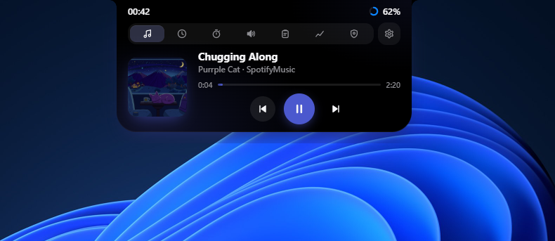

</div>

## Contents

- [Showcase](#showcase)
- [Widgets](#widgets)
- [Shortcuts](#shortcuts)
- [Install](#install)
- [Development](#development)
- [Project layout](#project-layout)
- [Contributing](#contributing)
- [CI and releases](#ci-and-releases)
- [License](#license)

## Showcase

### The pill

Folded, the island is a pill showing one widget on each side. You choose which in **Settings → Layout**.

<p align="center"></p>

### Tabs

Hover the pill to open it. Each widget has its own tab.

| Now playing | Volume mixer |
| :---: | :---: |
|  | 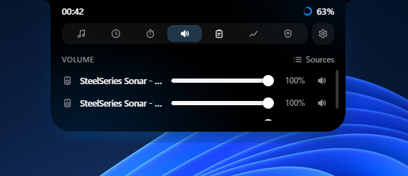 |
| **System stats** | **Mic & camera** |
| 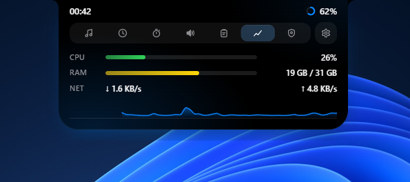 | 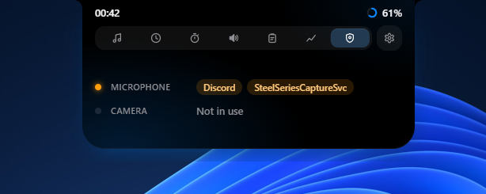 |
| **Clipboard** | |
| 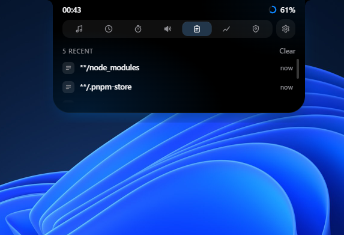 | |

### Multi-tool

Global shortcuts work even while the island is folded.

| Clipboard picker (<kbd>Win</kbd>+<kbd>Shift</kbd>+<kbd>B</kbd>) | Screenshot editor (<kbd>Win</kbd>+<kbd>Alt</kbd>+<kbd>S</kbd>) |
| :---: | :---: |
| 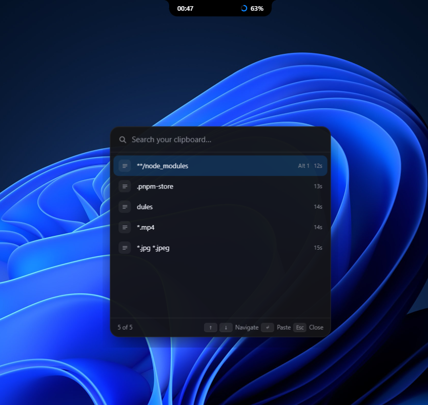 | 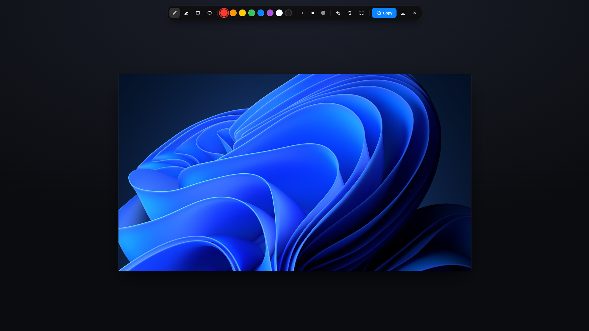 |

### Settings

Changes apply immediately and are saved automatically.

| General | Layout |
| :---: | :---: |
| 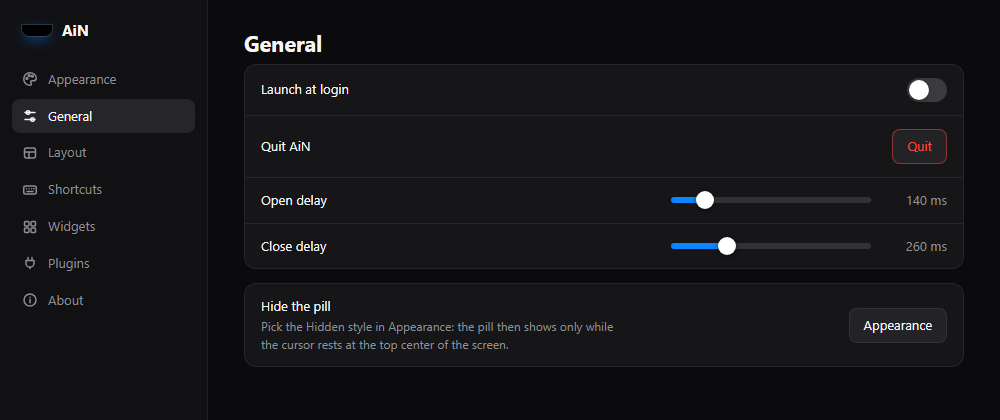 | 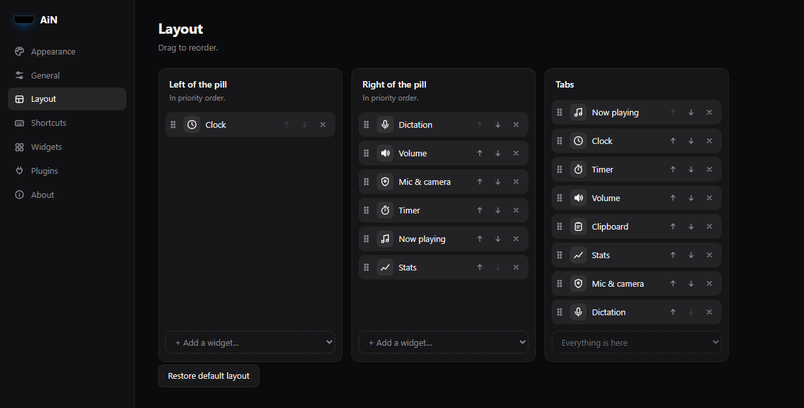 |
| **Shortcuts** | **Widgets** |
| 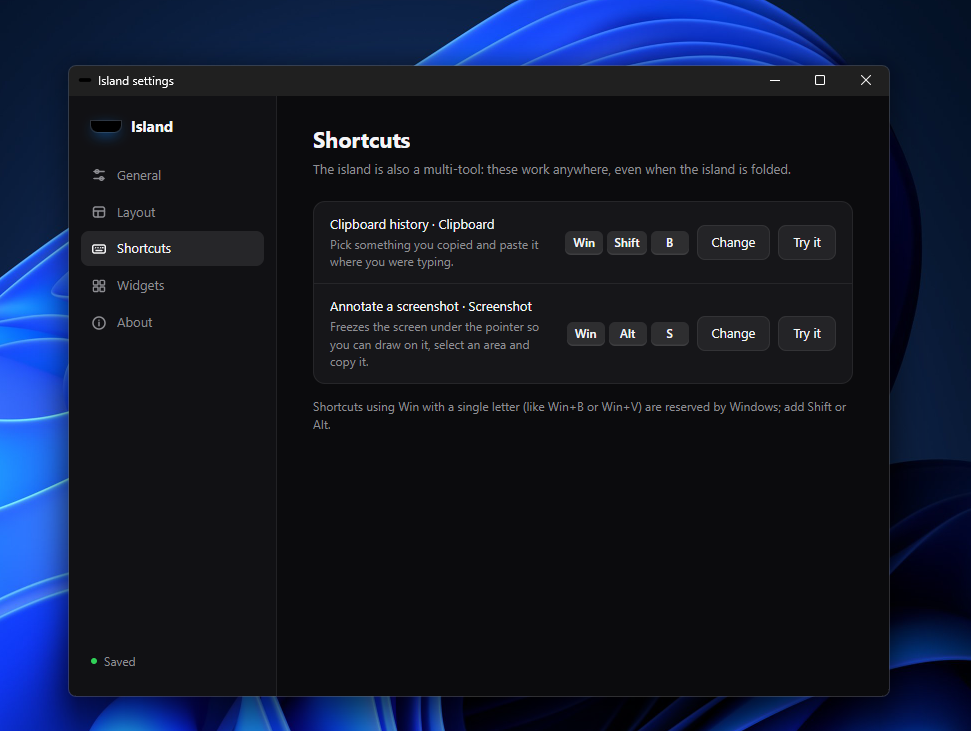 | 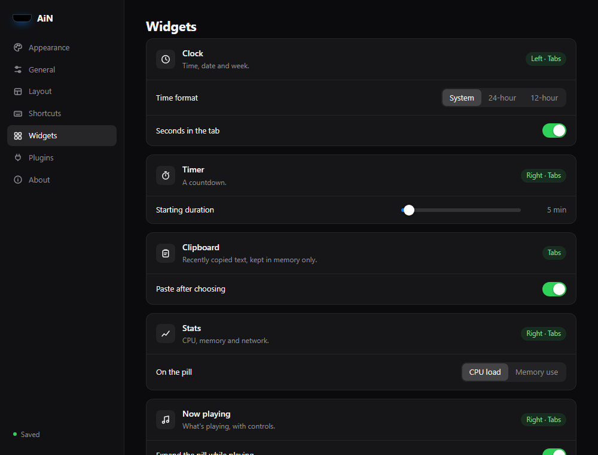 |

## Widgets

| Widget | What it does | Platforms |
| --- | --- | --- |
| **Clock** | The time on the pill. Its tab shows a counter-style clock with the date and week number. You can choose 12h, 24h or the system format. | All |
| **Timer** | A countdown with presets. It shows on the pill while it runs. | All |
| **Stats** | CPU, memory and network usage, with a live load graph on the pill | All |
| **Now playing** | Whatever plays through the system media controls (Spotify, browsers, players), with seek and playback controls | Windows, Linux (MPRIS) |
| **Volume** | A mixer for your outputs and apps. Pin the ones you want to adjust. A pop-up appears when the volume changes. | Windows, Linux (PipeWire/PulseAudio, no level meter) |
| **Mic & camera** | Which apps are using the microphone (orange) or camera (green) right now | Windows, Linux |
| **Clipboard** | Your recently copied text, one click to copy it again. It is kept in memory only and never written to disk. | All (picker: Windows) |
| **Screenshot** | Freezes the screen so you can draw on it. Select an area, then <kbd>Ctrl</kbd>+<kbd>C</kbd> to copy or <kbd>Ctrl</kbd>+<kbd>S</kbd> to save. | All |
| **Dictation** | Speak, and the words are typed where your cursor is. Speech is recognized on your computer by a model you download once. | Windows; Linux and macOS copy the text to paste instead |

You can reorder, add or remove widgets on the pill and in the tabs from **Settings → Layout**, and add widgets made by
others from **Settings → Plugins** (see [writing a plugin](docs/plugins.md)).

## Shortcuts

| Action | Default |
| --- | --- |
| Clipboard history picker | <kbd>Win</kbd>+<kbd>Shift</kbd>+<kbd>B</kbd> |
| Annotate a screenshot | <kbd>Win</kbd>+<kbd>Alt</kbd>+<kbd>S</kbd> |

You can rebind both in **Settings → Shortcuts**. On Windows, <kbd>Win</kbd> + a single letter is reserved by the
OS, so add <kbd>Shift</kbd> or <kbd>Alt</kbd>.

## Install

Download the latest build for your OS from [Releases](https://github.com/Satcomx00-x00/AiN/releases) (x64 only):

| OS | Packages |
| --- | --- |
| Windows | `.msi`, NSIS `.exe` (per-user install) |
| Linux | `.deb`, `.rpm`, `.AppImage` (requires `gtk-layer-shell`) |
| macOS | `.dmg`, `.app` |

> [!NOTE]
> The binaries are not signed yet, so Windows SmartScreen and macOS Gatekeeper will show a warning on first launch.

## Development

Requirements: [Bun](https://bun.sh) 1.3+, Rust stable, and the [Tauri prerequisites](https://tauri.app/start/prerequisites/) for your OS
(on Debian/Ubuntu: `.github/scripts/linux-deps.sh`).

```sh
cd widget-island
bun install
bun run tauri dev      # run the app
bun run typecheck      # tsc
bun run test           # vitest
bun run tauri build    # local bundle
```

Rust checks (from `widget-island/src-tauri`):

```sh
cargo fmt --check
cargo clippy --all-targets -- -D warnings
cargo test             # also regenerates the TypeScript bindings: commit them
```

How the code is organized, and how to add a feature: [docs/architecture.md](docs/architecture.md).

## Project layout

| Path | Content |
| --- | --- |
| `widget-island/src/sdk/` | The plugin API, shared by built-in features and third-party plugins |
| `widget-island/src/shell/` | The app itself: island host, layout, settings, shortcuts and each window's entry point |
| `widget-island/src/features/` | One folder per feature (UI side), each with its generated `bindings.ts` |
| `widget-island/src-tauri/src/manifest.rs` | Every IPC command and event, listed once |
| `widget-island/src-tauri/src/shell/` | Native side of the app: island window, popup, capture, settings, tray, plugin folder |
| `widget-island/src-tauri/src/features/` | Native side of each feature, with one backend per OS (`windows.rs`, `linux.rs`) |
| `widget-island/examples/plugins/` | Example third-party plugin |
| `cliff.toml` | [git-cliff](https://git-cliff.org) changelog configuration |
| `.github/workflows/` | CI and release pipelines |

## Contributing

Commits follow [Conventional Commits](https://www.conventionalcommits.org) (`feat:`, `fix:`, `perf:`, `refactor:`, `docs:`, `ci:`, `build:`, `chore:`…).
They are linted in CI, and for pull requests the title is linted too, since it becomes the squash-merge commit message.

### Git hooks

[prek](https://prek.j178.dev) (0.5.5 or later) runs the same checks locally. Install it
(`uv tool install prek`, `mise use prek` or `cargo binstall prek`), then once per clone, from the repository root:

```sh
prek install --prepare-hooks
```

Hooks only run where the change is, and keep the slow ones for `git push`:

| | Every commit (staged files) | Every push (files in the pushed commits) |
| --- | --- | --- |
| Anywhere | whitespace, line endings, large files, merge markers, private keys, secrets (gitleaks), spelling (typos) | |
| `widget-island/src` | `tsc` | the Vitest tests that import what changed |
| `widget-island/src-tauri` | `cargo fmt` (fixes) | `cargo clippy`, `cargo test` (which also regenerates the bindings) |
| `.github/workflows` | actionlint, zizmor | |
| Commit message | commitlint | |

`prek run --all-files` runs the commit hooks on everything, `--hook-stage pre-push` the push ones.
To skip one hook once: `PREK_SKIP=cargo-test git push`. Configuration: [`prek.toml`](prek.toml) and the
`prek.toml` files of the two projects; spelling exceptions go in [`_typos.toml`](_typos.toml).

## CI and releases

Every push to `main` and every pull request runs:

- commit message linting (commitlint)
- frontend: typecheck, unit tests, production build
- Rust: `rustfmt`, then `clippy -D warnings` and `cargo test` on Linux, Windows and macOS (x64), and a check that the
  committed TypeScript bindings match the Rust code
- an AppImage build, uploaded as a workflow artifact

Releases are continuous: every green CI run on `main` (a merged pull request, a push) can cut one.

1. git-cliff reads the Conventional Commits since the last tag. Only `feat`, `fix`, `perf` and breaking changes
   (`feat!:`, `BREAKING CHANGE:`) release; `docs`, `ci`, `chore`, `refactor`, `test`… wait for the next one.
2. It derives the bump (pre-1.0: a feature or a breaking change bumps the minor, anything else the patch), updates
   `package.json`, `Cargo.toml`, `Cargo.lock` and `CHANGELOG.md`, commits `chore(release): vX.Y.Z` and pushes the tag.
3. The app is built for Windows, Linux and macOS (x64).
4. The release is published with the changelog section as its notes.

Commits merged while CI runs are released together, by the run of the newest one. To release anyway, or to pick
the bump (`major` for 1.0.0), use **Actions → Release → Run workflow** on `main`: CI then runs first, as a gate.

If a build fails, the release stays a draft: fix the cause and re-run the failed jobs.

## License

[MIT](LICENSE) © 2026 Satcom
