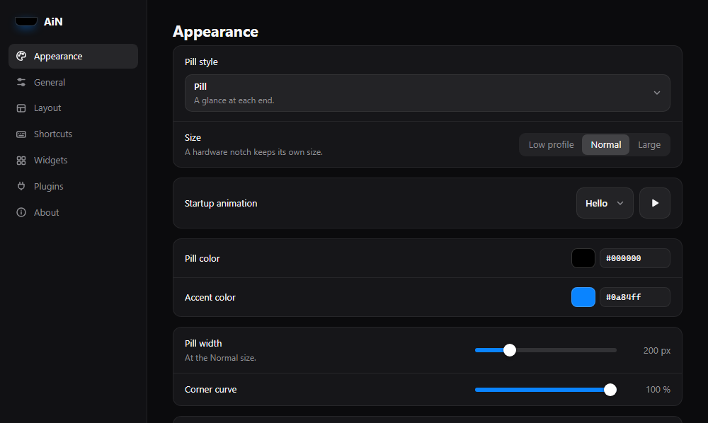

<div align="center">

# AiN

**All I Needed** — a dynamic-island style widget bar for the desktop.

A small pill sits at the top of your screen. Hover it and it unfolds into tabs for music, volume,
system stats, clipboard history and more, then folds back when you leave.

[](https://github.com/Satcomx00-x00/AiN/actions/workflows/ci.yml)
[](https://github.com/Satcomx00-x00/AiN/releases)
[](LICENSE)


</div>

## Contents

- [Showcase](#showcase)
- [Features](#features)
- [Shortcuts](#shortcuts)
- [Install](#install)
- [Development](#development)
- [Project layout](#project-layout)
- [Contributing](#contributing)
- [CI and releases](#ci-and-releases)
- [License](#license)

## Showcase

### The pill

Folded, the island is a pill showing one widget on each side. You choose which in **Settings → Layout**,
and its [style and size](#the-island) in **Settings → Appearance**.

<p align="center"></p>

Five styles, here with music playing:

| Pill | Solo |
| :---: | :---: |
|  |  |
| **Stub** | **Sliver** |
|  |  |

The fifth, Hidden, is the Pill kept out of sight until the cursor rests at the top center of the screen.

Three sizes, for every style:

| Low profile | Normal | Large |
| :---: | :---: | :---: |
|  |  |  |

When it starts, the island greets you with a short animation (Hello, here):

<p align="center"></p>

### Tabs

Hover the pill to open it. Each widget has its own tab.

| Now playing | Volume mixer |
| :---: | :---: |
|  |  |
| **System stats** | **Mic & camera** |
|  |  |
| **Clipboard** | |
|  | |

### Multi-tool

Global shortcuts work even while the island is folded.

| Clipboard picker (<kbd>Win</kbd>+<kbd>Shift</kbd>+<kbd>B</kbd>) | Screenshot editor (<kbd>Win</kbd>+<kbd>Alt</kbd>+<kbd>S</kbd>) |
| :---: | :---: |
|  |  |

### Settings

Changes apply immediately and are saved automatically.

| General | Layout |
| :---: | :---: |
|  |  |
| **Shortcuts** | **Widgets** |
|  |  |
| **Appearance** | |
|  | |

## Features

Everything below is **built in**: it comes with the app, nothing to install. [Plugins](#plugins) made by others
add to it, from the community store.

✅ works · ⚠️ works, with the limit noted · — doesn't apply

### The island

| Feature | What it does | Windows | macOS | Linux |
| --- | --- | :---: | :---: | :---: |
| **The pill** | Sits at the top center of the screen, above other windows and on every workspace | ✅ | ✅ | ✅ X11<br>⚠️ Wayland: pinned to the top on compositors with layer-shell (KDE, Sway, Hyprland…); on GNOME, through XWayland, just below the top bar |
| **Hover to open** | Unfolds into one tab per widget, folds back when the pointer leaves; the delays are adjustable | ✅ | ✅ | ✅ |
| **Live activities** | Music, a volume change or a dictation widens the pill for a moment, with a bounce | ✅ | ✅ | ✅ |
| **Notch** | On a MacBook with a notch, the pill wraps around it, with a glance on each side | — | ✅ | — |
| **Pill styles** | **Pill** (a glance at each end), **Solo** (one glance in the middle), **Stub** (a small tab with one mark), **Sliver** (a thin strip without text), **Hidden** (shows only while the cursor rests at the top center) | ✅ | ✅ | ✅ X11<br>⚠️ Wayland: Hidden stays shown, the compositor doesn't tell where the cursor is |
| **Pill sizes** | Low profile (20 px), normal (32 px) or large (44 px), for every style; text, icons and corners ease to the new size live | ✅ | ✅ (a notch keeps its own size) | ✅ |
| **Startup animations** | Hello, Boing, Sparkle or Typewriter when the island starts, or none; a Play button to preview; skipped when the system asks for reduced motion | ✅ | ✅ | ✅ |
| **Themes and colors** | 54 themes (AiN, Dracula, Nord, Tokyo Night, Gruvbox, Solarized…), your own pill and accent colors, the pill's width and corner curve | ✅ | ✅ | ✅ |
| **Layout** | Which widgets show on each side of the pill (the first with something to say wins) and the order of the tabs | ✅ | ✅ | ✅ |
| **Settings** | A settings window; changes apply at once and are saved automatically | ✅ | ✅ | ✅ |
| **Tray icon** | Opens the settings, quits the app | ✅ | ✅ | ⚠️ needs a tray that supports AppIndicator (GNOME: the AppIndicator extension) |
| **Launch at login** | Starts the island when you sign in | ✅ | ✅ | ✅ |

### Widgets

Each widget can show on the pill, in its own tab, or both.

| Widget | What it does | Windows | macOS | Linux |
| --- | --- | :---: | :---: | :---: |
| **Clock** | The time on the pill; its tab shows a counter-style clock with the date and week number. 12h, 24h or the system format | ✅ | ✅ | ✅ |
| **Timer** | A countdown with presets, shown on the pill while it runs; asks for attention when it ends | ✅ | ✅ | ✅ |
| **Stats** | CPU, memory and network usage, with a live load graph on the pill | ✅ | ✅ | ✅ |
| **Now playing** | What plays, with its cover art, seek and playback controls | ✅ any app using the system media controls | ⚠️ Spotify and Music only | ✅ MPRIS players (Spotify, Firefox, Chromium, VLC, mpv…) |
| **Volume** | A mixer for your outputs and apps; pin the ones you want. A pop-up shows on the pill when the volume changes | ✅ outputs and apps, with a level meter | ⚠️ outputs only (macOS has no per-app volume), no level meter | ⚠️ outputs and apps, no level meter |
| **Mic & camera** | Which apps use the microphone (orange) or the camera (green) right now | ✅ | ⚠️ apps on the mic from macOS 14; for the camera, only that one is in use | ✅ your own apps |
| **Clipboard** | Your recently copied text, one click to copy it again; kept in memory only, never written to disk | ✅ | ✅ | ✅ |
| **Dictation** | Speak, and the words are typed where your cursor is. Recognized on your computer by one of 7 models you download once (Parakeet, Whisper, SenseVoice, Moonshine) | ✅ | ⚠️ typing needs Accessibility access | ⚠️ typing needs `xdotool` (X11), `wtype` or `ydotool` (Wayland) |

Where typing isn't allowed, dictated text is copied for you to paste (see [permissions](#permissions-and-helper-tools)).

### Shortcut tools

Global shortcuts open these even while the island is folded. You can rebind them in **Settings → Shortcuts**.

| Tool | What it does | Windows | macOS | Linux |
| --- | --- | :---: | :---: | :---: |
| **Clipboard picker** | Search your clipboard history, pick with the arrows or <kbd>Alt</kbd>+<kbd>1</kbd>…<kbd>9</kbd>, and it is pasted into the app you were in | ✅ | ⚠️ pasting needs Accessibility access | ⚠️ shortcut on X11 only; pasting needs `xdotool`, `wtype` or `ydotool` |
| **Screenshot editor** | Freezes the screen; select an area, draw on it (pen, marker, rectangle, ellipse, colors, sizes, undo), then copy or save it as a PNG | ✅ | ✅ | ⚠️ shortcut on X11 only |
| **Dictation** | Starts and stops dictating | ✅ | ✅ | ⚠️ shortcut on X11 only |

On Wayland, Linux gives apps no global shortcuts: the island and its tabs work, the shortcuts don't.

### Plugins

The app can load widgets, startup animations and pill styles from a plugins folder (**Settings → Plugins**), on
every OS. None ship with it: install them from the **community store** at the bottom of that page, or drop a file
in the folder yourself.

The store is [`store.yaml`](https://github.com/Satcomx00-x00/AiN/blob/store/store.yaml) on the `store` branch, read
over the internet, so new plugins show up without a new release. To write one, start from the
[`plugin-template`](https://github.com/Satcomx00-x00/AiN/tree/plugin-template) branch (a clock), or
[`plugin-template-calendar`](https://github.com/Satcomx00-x00/AiN/tree/plugin-template-calendar) for one that signs in
to an online account (Google Calendar), read
[writing a plugin](docs/plugins.md) and the examples in `ain/examples/plugins/`, then open a pull request against
the `store` branch to list it.

## Shortcuts

| Action | Default |
| --- | --- |
| Clipboard history picker | <kbd>Win</kbd>+<kbd>Shift</kbd>+<kbd>B</kbd> |
| Annotate a screenshot | <kbd>Win</kbd>+<kbd>Alt</kbd>+<kbd>S</kbd> |
| Start or stop dictation | <kbd>Ctrl</kbd>+<kbd>Alt</kbd>+<kbd>D</kbd> |

You can rebind them all in **Settings → Shortcuts**. On Windows, <kbd>Win</kbd> + a single letter is reserved by the
OS, so add <kbd>Shift</kbd> or <kbd>Alt</kbd>. On macOS, <kbd>Win</kbd> is <kbd>Cmd</kbd>; on Linux, the Super key.
On Linux, global shortcuts work on X11 only.

## Install

Download the latest build for your OS from [Releases](https://github.com/Satcomx00-x00/AiN/releases) (x64 only):

| OS | Packages |
| --- | --- |
| Windows | `.msi`, NSIS `.exe` (per-user install) |
| Linux | `.deb`, `.rpm`, `.AppImage` (requires `gtk-layer-shell`) |
| macOS | `.dmg`, `.app` |

> [!NOTE]
> The binaries are not signed yet, so Windows SmartScreen and macOS Gatekeeper will show a warning on first launch.

> [!IMPORTANT]
> Up to v0.1.2 the app was called **widget**. AiN installs as a new app: quit the old one, start AiN once (it brings
> over your settings, plugins, downloaded speech models and launch-at-login choice), then uninstall **widget**.

### Permissions and helper tools

Typing dictated text and pasting from the clipboard picker press keys in another app, which macOS and Linux only
allow in some conditions. When they can't, the text stays on the clipboard for you to paste.

| OS | What it needs |
| --- | --- |
| macOS | Allow AiN under **System Settings → Privacy & Security → Accessibility** (macOS asks the first time). Now playing asks once to control Spotify or Music, and dictation to use the microphone. |
| Linux, X11 | [`xdotool`](https://github.com/jordansissel/xdotool) |
| Linux, Wayland | [`wtype`](https://github.com/atx/wtype) (wlroots compositors, KDE), or [`ydotool`](https://github.com/ReimuNotMoe/ydotool) with its daemon running and its socket open to you (any compositor, GNOME included; Fedora's `ydotool.service` keeps its socket root-only in `/tmp`, where the client doesn't look: run `ydotoold --socket-path=$XDG_RUNTIME_DIR/.ydotool_socket --socket-own=$(id -u):$(id -g)` instead) |

## Development

Requirements: [Bun](https://bun.sh) 1.3+, Rust stable, and the [Tauri prerequisites](https://tauri.app/start/prerequisites/) for your OS
(on Debian/Ubuntu: `.github/scripts/linux-deps.sh`).

```sh
cd ain
bun install
bun run tauri dev      # run the app
bun run typecheck      # tsc
bun run test           # unit and integration tests (vitest)
bun run tauri build    # local bundle
```

Tests:

| Command | What it runs |
| --- | --- |
| `bun run test` | Unit tests next to the code (`src/**/*.test.ts`), plus the integration flows in `src/integration`: the real island and settings page on fake system services |
| `bun run test:coverage` | The same, with a coverage report in `coverage/` |
| `bun run test:e2e` | End-to-end tests in Chromium (`e2e/`): the island, settings, clipboard popup and capture editor on the dev server, with real layout, pointer and animations |
| `bun run test:smoke` | Smoke tests (`smoke/`): builds, then opens each window of the production build with a stand-in for the Tauri backend |
| `bun run screenshots` | Retakes the README's pictures of the pill styles, sizes, startup animation and appearance settings (`screenshots/`), into `img/` |

The browser tests run in Chromium (the engine of Windows' WebView2) and WebKit (the engine of macOS' WKWebView and
Linux's WebKitGTK). Install them once: `bunx playwright install chromium webkit`.

Rust checks (from `ain/src-tauri`):

```sh
cargo fmt --check
cargo clippy --all-targets -- -D warnings
cargo test             # also regenerates the TypeScript bindings: commit them
```

How the code is organized, and how to add a feature: [docs/architecture.md](docs/architecture.md).

## Project layout

| Path | Content |
| --- | --- |
| `ain/src/sdk/` | The plugin API, shared by built-in features and third-party plugins |
| `ain/src/shell/` | The app itself: island host, layout, settings, shortcuts and each window's entry point |
| `ain/src/features/` | One folder per feature (UI side), each with its generated `bindings.ts` |
| `ain/src-tauri/src/manifest.rs` | Every IPC command and event, listed once |
| `ain/src-tauri/src/shell/` | Native side of the app: island window, popup, capture, settings, tray, plugin folder |
| `ain/src-tauri/src/features/` | Native side of each feature, with one backend per OS (`windows.rs`, `linux.rs`, `macos.rs`) |
| `ain/examples/plugins/` | Example third-party plugins: a widget, a startup animation, a pill style |
| `cliff.toml` | [git-cliff](https://git-cliff.org) changelog configuration |
| `.github/workflows/` | CI and release pipelines |

## Contributing

Commits follow [Conventional Commits](https://www.conventionalcommits.org) (`feat:`, `fix:`, `perf:`, `refactor:`, `docs:`, `ci:`, `build:`, `chore:`…).
They are linted in CI, and for pull requests the title is linted too, since it becomes the squash-merge commit message.

### Git hooks

[prek](https://prek.j178.dev) (0.5.5 or later) runs the same checks locally. Install it
(`uv tool install prek`, `mise use prek` or `cargo binstall prek`), then once per clone, from the repository root:

```sh
prek install --prepare-hooks
```

Hooks only run where the change is, and keep the slow ones for `git push`:

| | Every commit (staged files) | Every push (files in the pushed commits) |
| --- | --- | --- |
| Anywhere | whitespace, line endings, large files, merge markers, private keys, secrets (gitleaks), spelling (typos) | |
| `ain/src` | `tsc` | the Vitest tests that import what changed |
| `ain/src-tauri` | `cargo fmt` (fixes) | `cargo clippy`, `cargo test` (which also regenerates the bindings) |
| `.github/workflows` | actionlint, zizmor | |
| Commit message | commitlint | |

`prek run --all-files` runs the commit hooks on everything, `--hook-stage pre-push` the push ones.
To skip one hook once: `PREK_SKIP=cargo-test git push`. Configuration: [`prek.toml`](prek.toml) and the
`prek.toml` files of the two projects; spelling exceptions go in [`_typos.toml`](_typos.toml).

## CI and releases

Every push to `main` and every pull request runs:

- commit message linting (commitlint)
- frontend: typecheck, unit and integration tests, production build
- browser tests: end-to-end tests and smoke tests of the production build, in Chromium and WebKit
- Rust: `rustfmt`, then `clippy -D warnings` and `cargo test` on Linux, Windows and macOS (x64), and a check that the
  committed TypeScript bindings match the Rust code
- an AppImage build, uploaded as a workflow artifact, then launched on a virtual display: it must start, lay out its
  window and keep running (`.github/scripts/launch-check.sh`)

Releases are continuous: every green CI run on `main` (a merged pull request, a push) can cut one.

1. git-cliff reads the Conventional Commits since the last tag. Only `feat`, `fix`, `perf` and breaking changes
   (`feat!:`, `BREAKING CHANGE:`) release; `docs`, `ci`, `chore`, `refactor`, `test`… wait for the next one.
2. It derives the bump (pre-1.0: a feature or a breaking change bumps the minor, anything else the patch), updates
   `package.json`, `Cargo.toml`, `Cargo.lock` and `CHANGELOG.md`, commits `chore(release): vX.Y.Z` and pushes the tag.
3. The app is built for Windows, Linux and macOS (x64).
4. The release is published with the changelog section as its notes.

Commits merged while CI runs are released together, by the run of the newest one. To release anyway, or to pick
the bump (`major` for 1.0.0), use **Actions → Release → Run workflow** on `main`: CI then runs first, as a gate.

If a build fails, the release stays a draft: fix the cause and re-run the failed jobs.

## License

[MIT](LICENSE) © 2026 Satcom
