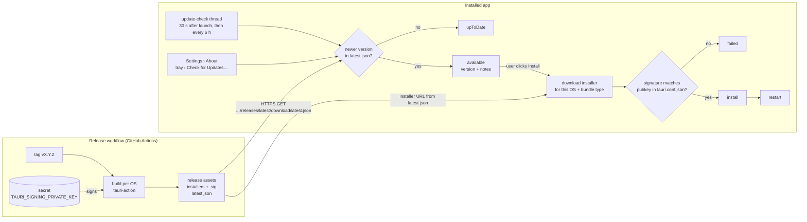
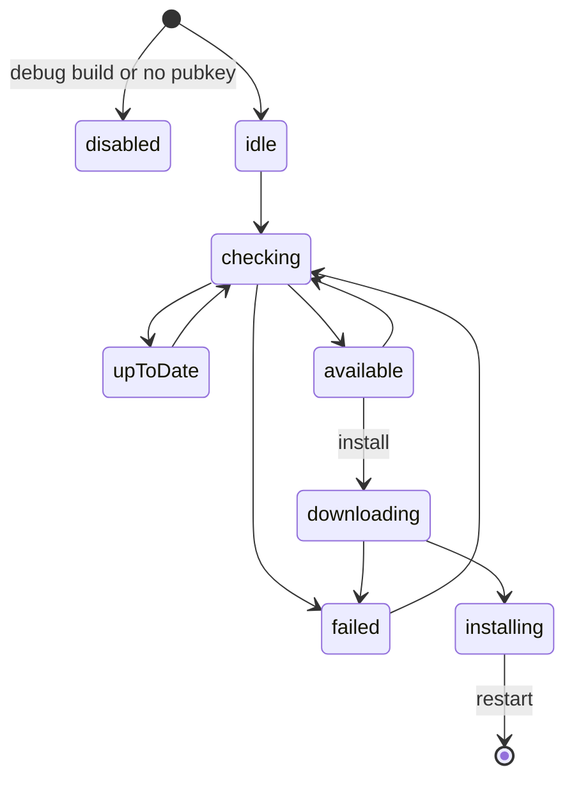

# Updates

AiN updates itself on Windows, macOS and Linux with
[`tauri-plugin-updater`](https://v2.tauri.app/plugin/updater/). The code is in
[`src-tauri/src/shell/updater.rs`](../ain/src-tauri/src/shell/updater.rs) (backend) and
[`src/shell/updater.ts`](../ain/src/shell/updater.ts) (the port Settings uses).

## How it works



1. **Publish.** Each release build signs its installer with the private key and `tauri-action`
   merges an entry for its platform into the release's `latest.json`:

   ```json
   {
     "version": "0.2.0",
     "notes": "…release notes…",
     "pub_date": "2026-10-16T12:00:00Z",
     "platforms": {
       "windows-x86_64": { "url": "https://…/widget_0.2.0_x64-setup.exe", "signature": "…" },
       "darwin-x86_64":  { "url": "https://…/widget_x64.app.tar.gz",        "signature": "…" },
       "linux-x86_64":   { "url": "https://…/widget_0.2.0_amd64.AppImage",  "signature": "…" }
     }
   }
   ```

2. **Check.** The app fetches the latest release's `latest.json` from [GitHub](#release-host),
   and compares its `version` with its own (semver). It checks on its own, but never downloads
   without the user.
3. **Install.** On the user's go it downloads the file for its own platform *and* bundle type,
   verifies its signature against the public key built into the app, installs it and restarts.

| Platform | Installed as | What the updater does |
| --- | --- | --- |
| Windows | NSIS (`-setup.exe`) or MSI | runs the installer in passive mode (progress bar, no questions); per-user install, so no admin prompt |
| macOS | `.app` | replaces the bundle with the one from `.app.tar.gz` |
| Linux | AppImage | replaces the AppImage file in place |
| Linux | `.deb` / `.rpm` | installs the package with `dpkg -i` / `rpm -U`, asking for the password through `pkexec` |

The state the backend reports (and emits as `UpdateChanged` on every change):



Only one check or install runs at a time: a check asked for while one is running returns the
current state instead.

## Release host

Releases come from GitHub: `REPO` in `updater.rs` (`Satcomx00-x00/AiN`) gives
`https://github.com/<repo>/releases/latest/download/latest.json`, which GitHub redirects to the
`latest.json` asset of the newest published (non-draft, non-prerelease) release. The release
workflow only publishes a release once its builds are uploaded, so apps never see a half-built one.

The repository must stay public: a private one would need a token shipped inside the app.

## Setting it up (once)

Until this is done, release builds report "This build has no update key", and releases build as
before, without `latest.json`.

1. Generate the key pair (keep the private key and its password out of the repository):

   ```sh
   cd ain
   bun tauri signer generate -w ~/.tauri/island.key
   ```

2. Put the **public** key (content of `island.key.pub`) in
   `src-tauri/tauri.conf.json` → `plugins.updater.pubkey`, and commit it.
3. Add the repository secrets `TAURI_SIGNING_PRIVATE_KEY` (content of `island.key`) and
   `TAURI_SIGNING_PRIVATE_KEY_PASSWORD`. The release workflow then turns on
   `bundle.createUpdaterArtifacts` and `tauri-action` uploads `latest.json`.

Losing the private key means installed apps can never be updated again (they only trust the key
they were built with): back it up.

Versions released before step 3 have no updater and must be updated by hand once.

## Tests in CI

| Where | What | When |
| --- | --- | --- |
| [`src-tauri/tests/update_flow.rs`](../ain/src-tauri/tests/update_flow.rs) | A Tauri app (mock runtime) with the real updater plugin checks a local server: finds a newer version, downloads it, accepts a good signature, rejects a tampered file or another key's signature, ignores same or older versions; and `tauri.conf.json` ships a real key, not the test one | every CI run, on Windows, Linux and macOS (`cargo test`) |
| [`check-update-manifest.py`](../.github/scripts/check-update-manifest.py) | The release's `latest.json` announces this version, has `windows-x86_64`, `darwin-x86_64` and `linux-x86_64`, points each entry at a file of the release, and each signature verifies against the app's key | each release, while still a draft: a failure leaves it unpublished |
| [`test-check-update-manifest.sh`](../.github/scripts/test-check-update-manifest.sh) | The checker above, against the signed fixtures | every CI run |

The fixtures (`src-tauri/tests/fixtures/updater/`) are signed with a test-only key; how to
re-sign them is at the top of `update_flow.rs`. Not covered: running the installers themselves.

## Testing an update by hand

Without publishing anything: an old portable build reads `latest.json` from a local server
through `AIN_UPDATE_URL` (the signature is still checked).

1. Old version, portable, allowed to read plain `http://`:
   `tauri build --no-bundle --config '{"version":"0.1.0","plugins":{"updater":{"dangerousInsecureTransportProtocol":true}}}'`
   and copy `target/release/ain.exe` aside.
2. New version, signed (with `TAURI_SIGNING_PRIVATE_KEY` and `TAURI_SIGNING_PRIVATE_KEY_PASSWORD`
   set): `tauri build --bundles nsis --config '{"version":"0.2.0","bundle":{"createUpdaterArtifacts":true}}'`.
3. Put the `-setup.exe` and a `latest.json` (its `windows-x86_64` entry: the installer's URL and
   the content of its `.sig`) in a folder and serve it: `python -m http.server 8765`.
4. Start the old exe with `AIN_UPDATE_URL=http://localhost:8765/latest.json`, then
   Settings › About › Check now → Install and restart.

On Windows the update always runs the NSIS installer: from a portable exe, it installs the new
version (per user, in `%LOCALAPPDATA%`) and starts it, leaving the portable file as it was.

## Not done yet

- A notice on the island itself when an update is available (only Settings and the tray show it).
- A setting to turn automatic checks off, or a beta channel (a second `latest.json`).
- `requireSignedVersion` (refuses an old, validly signed release announced as new): to turn on
  once every published release is signed by a CLI that records the version in the signature.
- macOS code signing and notarization; arm64 builds (Apple Silicon, Windows/Linux ARM) — each
  new target adds its own entry to `latest.json`.
